# Database Diagram — TrackPoli

Entity-relationship diagram of the whole TrackPoli database. GitHub renders the Mermaid block below
as a picture. The database has **two layers**, both shown here:

- **Built foundation / auth layer** — as-built, rendered from the real migrations `001`–`011`
  (`observed`). These tables exist today: admin identity, audit and ops logging, rate limits,
  sign-in lockouts, and terms/privacy acceptance.
- **Proposed accountability domain** — the political-record tables (`inferred` / `documented`). These
  are **not built yet** (`observed`: no such tables in `supabase/migrations/`); every column, key and
  cardinality is a proposal to validate, derived from the requirements document and `decisions.md`.
  It becomes as-built only once SQL migrations add it and it is re-checked against Supabase's Schema
  Visualizer.

Human-authored **prose** (plain-language explanations, manifesto narrative) lives in **Sanity**, not
here — columns ending `_ref` are references to a Sanity document id, never a copy of a fact
(`decisions.md`: "Supabase owns facts, Sanity owns prose").

```mermaid
erDiagram
    %% ---------- BUILT foundation / auth (migrations 001-011, as-built) ----------
    USERS ||--|| PROFILES : "is"
    PROFILES ||--o{ NOTIFICATION_PREFERENCES : "has"
    PROFILES ||..o{ ACTIVITY_EVENTS : "actor (logical, no FK)"
    PROFILES ||..o{ OPERATIONAL_EVENTS : "actor id (logical)"
    PROFILES ||..o{ POLICY_ACCEPTANCES : "accepts (logical, no FK)"
    POLICY_VERSIONS ||..o{ POLICY_ACCEPTANCES : "version accepted (logical)"

    %% ---------- Bridge: built admin layer governs proposed domain ----------
    PROFILES ||--o{ POLITICIANS : "verifies / publishes"

    %% ---------- PROPOSED accountability domain ----------
    POLITICIANS ||--o{ OFFICE_TERMS : "holds over time"
    POLITICIANS ||--o{ PARTY_MEMBERSHIPS : "member over time"
    PARTIES ||--o{ PARTY_MEMBERSHIPS : "has members over time"
    POLITICIANS ||--o{ STANCES : "takes — said (polymorphic subject)"
    PARTIES ||--o{ STANCES : "takes — said (polymorphic subject)"
    ISSUES ||--o{ STANCES : "subject of"
    POLITICIANS ||--o{ VOTES : "casts — did"
    BILLS ||--o{ VOTES : "voted on"
    BILLS ||--o{ BILL_ISSUES : "tagged with"
    ISSUES ||--o{ BILL_ISSUES : "tags"
    POLITICIANS ||--o{ PROMISES : "makes (polymorphic subject)"
    PARTIES ||--o{ PROMISES : "makes (polymorphic subject)"
    ISSUES ||--o{ PROMISES : "about"
    ISSUES ||--o{ POLICIES : "about"
    PROMISES ||--o{ PROMISE_STATUS_HISTORY : "status over time"
    POLICIES ||--o{ POLICY_STATUS_HISTORY : "status over time"
    ISSUES ||--o{ ISSUES : "parent of (taxonomy)"
    SOURCES ||--o{ SOURCE_LINKS : "cited via"

    USERS {
        uuid id PK "built-in auth.users"
    }
    PROFILES {
        uuid id PK "BUILT - references auth.users"
        citext email "unique; restricted (data-map)"
        text display_name "restricted (data-map)"
        admin_role role "enum: admin|..."
        admin_status status "enum: invited|active|..."
        uuid invited_by
        timestamptz last_sign_in_at
        timestamptz created_at
        timestamptz updated_at
    }
    NOTIFICATION_PREFERENCES {
        uuid admin_id PK "BUILT - FK -> profiles, cascade"
        text key PK
        jsonb value
    }
    ACTIVITY_EVENTS {
        bigint id PK "BUILT - audit trail"
        timestamptz occurred_at
        uuid actor_id "logical -> profiles (no FK: log outlives profile)"
        text actor_name "snapshot"
        text actor_email "snapshot; internal (data-map)"
        text action "e.g. politician.publish"
        text subject_type "what was acted on"
        text subject_id
        jsonb details
        inet ip "internal (data-map)"
    }
    OPERATIONAL_EVENTS {
        bigint id PK "BUILT - ops/error log"
        timestamptz occurred_at
        ops_severity severity "enum"
        text source "edge_function|database|auth_hook|job"
        text component
        text message
        uuid actor_id "id only, never name/email"
        jsonb context
    }
    RATE_LIMITS {
        text key PK "BUILT"
        timestamptz window_start PK
        integer hits
    }
    POLICY_VERSIONS {
        text document PK "BUILT - 'terms' | 'privacy'"
        text current_version
        timestamptz published_at
    }
    POLICY_ACCEPTANCES {
        bigint id PK "BUILT"
        uuid admin_id "logical -> profiles (no FK: outlives account)"
        text admin_email "snapshot; internal (data-map)"
        text document "'terms' | 'privacy'"
        text version
        timestamptz accepted_at
        inet ip "internal (data-map)"
    }
    SIGN_IN_LOCKOUTS {
        text email_hash PK "BUILT - SHA-256 of email; not-personal (data-map)"
        integer failures
        timestamptz window_start
        integer strikes
        timestamptz locked_until
    }

    POLITICIANS {
        uuid id PK "PROPOSED"
        text full_name "proposed class: public"
        date date_of_birth "proposed class: public"
        text slug "unique, URL key"
        text status "enum: active|former|deceased"
        text bio_ref "-> Sanity prose"
        text publication_status "draft|published"
        timestamptz verified_at
        uuid verified_by FK "-> profiles (built admin identity)"
        boolean superseded "revision flag (SFR-14)"
        timestamptz updated_at
    }
    PARTIES {
        uuid id PK "PROPOSED"
        text name "public"
        text abbreviation
        text slug "unique, URL key"
        date founded_on
        text agenda_ref "-> Sanity prose"
        text publication_status "draft|published"
    }
    OFFICE_TERMS {
        uuid id PK "PROPOSED"
        uuid politician_id FK
        text office "enum: president|governor|senator|rep|..."
        text jurisdiction "federal|state|LGA + name"
        date term_start
        date term_end "null = current (derived)"
        text publication_status
    }
    PARTY_MEMBERSHIPS {
        uuid id PK "PROPOSED"
        uuid politician_id FK
        uuid party_id FK
        date joined_on
        date left_on "null = current; switch = new row"
    }
    ISSUES {
        uuid id PK "PROPOSED"
        uuid parent_id FK "self-ref; shared taxonomy"
        text name
        text slug "unique"
    }
    STANCES {
        uuid id PK "PROPOSED — 'said'"
        text subject_type "politician|party"
        uuid subject_id "-> politicians|parties"
        uuid issue_id FK
        text position "enum: supports|opposes|mixed|unclear"
        text detail_ref "-> Sanity prose"
        date effective_from
        date effective_to "null = current"
        text publication_status
    }
    BILLS {
        uuid id PK "PROPOSED"
        text title
        text status "enum: introduced|committee|passed|signed|rejected"
        date bill_date
        text summary_ref "-> Sanity prose"
        text publication_status
    }
    BILL_ISSUES {
        uuid bill_id FK "PROPOSED"
        uuid issue_id FK
    }
    VOTES {
        uuid id PK "PROPOSED — 'did'"
        uuid bill_id FK
        uuid politician_id FK
        text position "support|oppose|abstain|absent"
        date voted_on
    }
    PROMISES {
        uuid id PK "PROPOSED"
        text subject_type "politician|party"
        uuid subject_id "-> politicians|parties"
        uuid issue_id FK
        text summary_ref "-> Sanity prose"
        date made_on
        text current_status "denormalized latest"
    }
    PROMISE_STATUS_HISTORY {
        uuid id PK "PROPOSED"
        uuid promise_id FK
        text status "pending|in_progress|kept|broken|stalled"
        date as_of
    }
    POLICIES {
        uuid id PK "PROPOSED"
        uuid issue_id FK
        text title
        text current_status
        text summary_ref "-> Sanity prose"
    }
    POLICY_STATUS_HISTORY {
        uuid id PK "PROPOSED"
        uuid policy_id FK
        text status
        date as_of
    }
    SOURCES {
        uuid id PK "PROPOSED"
        text provider
        date published_on
        text affiliation "independent|state|partisan|unknown"
        text document_url
        text health_status "live|stale|dead (SNFR-14)"
        timestamptz last_checked_at
    }
    SOURCE_LINKS {
        uuid id PK "PROPOSED — shared provenance link"
        uuid source_id FK
        text subject_type "politician|stance|vote|bill|promise|policy"
        uuid subject_id "-> any claim-bearing row"
        text role "original_document|supporting|contradicting"
    }
```

## Legend — built vs. proposed

- **Built (as-built, migrations 001–011):** `USERS` (auth), `PROFILES`, `NOTIFICATION_PREFERENCES`,
  `ACTIVITY_EVENTS`, `OPERATIONAL_EVENTS`, `RATE_LIMITS`, `POLICY_VERSIONS`, `POLICY_ACCEPTANCES`,
  `SIGN_IN_LOCKOUTS`. Dotted lines (`..`) are deliberate **logical** links with **no database foreign
  key** — the audit and acceptance logs must outlive a deleted admin profile.
- **Proposed (not yet built):** every accountability table — `POLITICIANS`, `PARTIES`, `OFFICE_TERMS`,
  `PARTY_MEMBERSHIPS`, `ISSUES`, `STANCES`, `BILLS`, `BILL_ISSUES`, `VOTES`, `PROMISES`,
  `PROMISE_STATUS_HISTORY`, `POLICIES`, `POLICY_STATUS_HISTORY`, `SOURCES`, `SOURCE_LINKS`.
- **The bridge:** the built `PROFILES` (admin identity) verifies/publishes the proposed records, and
  the built `ACTIVITY_EVENTS` audits them via its generic `subject_type` / `subject_id` — which is why
  this is one database, not two.

## How the five load-bearing patterns work (accountability domain)

1. **Provenance is structural, not optional** (`SNFR-2`, `SFR-12`). Every factual claim attaches its
   evidence through the **one shared `SOURCE_LINKS` table** (`source_id` + polymorphic `subject_type`
   / `subject_id`). No free-text "source" column; the publish rule (`SNFR-12`, no claim published
   without ≥1 source) is enforced over this table.
2. **"Said" and "did" are separate** (`SNFR-4`). A `STANCE` and a `VOTE` are distinct, meeting only
   through a shared `ISSUE`, so the two can be compared, never conflated.
3. **Temporal validity, append-only** (`SNFR-3`). `OFFICE_TERMS`, `PARTY_MEMBERSHIPS`, `STANCES` carry
   `*_from` / `*_to`; "current" is derived, never a stored mirror. A party switch is a new row.
4. **Draft vs. published** (`decisions.md`). Publication is state on the record
   (`publication_status`, `verified_at`, `verified_by`, `superseded`); the public reads only a
   published projection. *(Modeling decision — see ADR-0037.)*
5. **Supabase owns facts, Sanity owns prose** (`decisions.md`). `_ref` columns hold a Sanity id; the
   multi-rendition content layer (`SFR-15`) lives in Sanity, outside this relational ERD.

## Entity → requirement traceability (proposed domain)

| Entity | Primary source | Priority |
|---|---|---|
| POLITICIANS | SFR-1 | Must |
| OFFICE_TERMS | SFR-2 | Must |
| PARTY_MEMBERSHIPS | SFR-3 | Must |
| PARTIES | SFR-5 | Must |
| ISSUES | SFR-6 / SNFR-6 | Must |
| STANCES | SFR-4 / SNFR-4 | Must |
| BILLS / BILL_ISSUES | SFR-8, SFR-6 | Must |
| VOTES | SFR-8 / SNFR-4 | Must |
| PROMISES | SFR-10 | Must |
| PROMISE_STATUS_HISTORY | SFR-11 | Should |
| POLICIES / POLICY_STATUS_HISTORY | SFR-11 | Should |
| SOURCES | SFR-13 | Must |
| SOURCE_LINKS | SFR-12 / SNFR-2 | Must |

## Evidence & limitations

- **Foundation layer: `observed` (as-built).** Source (re-runnable): `supabase/migrations/001`–`011`.
  The foundation tables, columns, keys and the deliberate no-FK logical links are rendered from that
  real DDL. Limitation: reflects the migrations at this commit; a column could change in a later migration.
- **Accountability domain: `inferred` / `documented` (proposed, unbuilt).** Sources: the requirements
  document (SFR-1…16, SNFR-1…16) and `decisions.md`. `observed`: no politician/party/bill/vote/source
  table exists in `supabase/migrations/`, so its columns and keys are a proposal to validate.
- **PII classes for proposed tables are proposed, not tagged.** `observed`: `data-map.json` currently
  tags only the foundation fields. The classes on `POLITICIANS` must be added to `data-map.json` when
  those tables land, or the untagged-PII gate will (correctly) block them.
- **MVP scope is inferred.** The Vision/Scope + EFT board (user-story wording and the MVP-vs-MMP split)
  could not be read (pasted into the requirements doc as images). Scope follows the `Must` MoSCoW tags
  — *to confirm against the board.*
- **Open modeling decisions** (flagged in ADR-0037): draft/published as record state vs. projection
  tables; polymorphic `SOURCE_LINKS` subject vs. per-type joins; `subject_type`+`subject_id` pair vs.
  two nullable FKs on `STANCES` / `PROMISES`.
